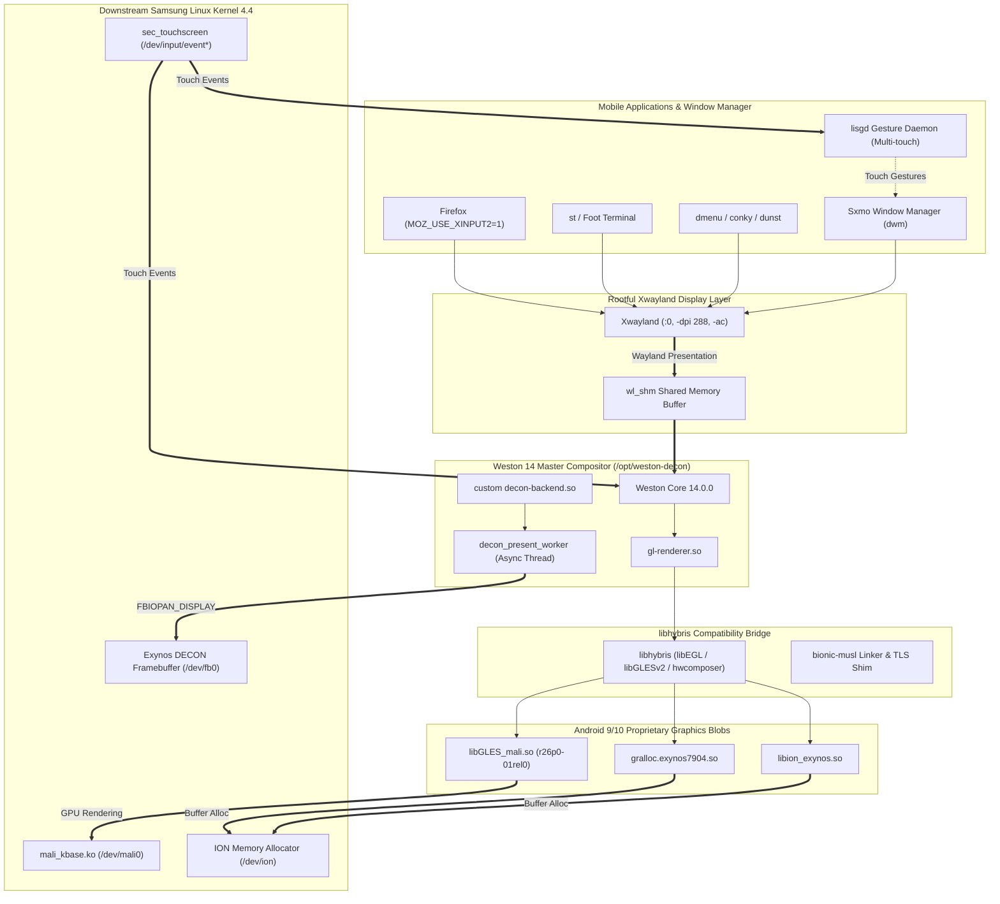

# Mali-G71 MP2 Hardware Graphics Acceleration for Samsung Galaxy A30 (postmarketOS)

[](https://opensource.org/licenses/MIT)
[-blue.svg)](#target-hardware-specifications)
[-teal.svg)](https://postmarketos.org/)
[-orange.svg)](#target-hardware-specifications)
[](#architecture)

This repository provides a complete, production-ready **hardware-accelerated graphics stack** and desktop environment setup for the **Samsung Galaxy A30** (`SM-A305F` / `a30`) running **postmarketOS** (Alpine musl Linux, kernel `4.4.177` / `4.4.302`).

By bridging downstream vendor Mali graphics libraries via `libhybris` into a custom **Direct-DECON Weston 14 compositor** and providing an optimized **rootful Xwayland** display layer, this project achieves real-time **60 FPS** accelerated mobile desktop sessions with **Sxmo (dwm)** and OpenGL ES hardware acceleration.

---

## Table of Contents

- [Key Achievements](#key-achievements)
- [Architecture](#architecture)
- [Target Hardware Specifications](#target-hardware-specifications)
- [Installation Guide](#installation-guide)
  - [Prerequisites](#prerequisites)
  - [Method 1: Fast Restore from Backup Bundle](#method-1-fast-restore-from-backup-bundle)
  - [Method 2: Clean Setup from Scratch](#method-2-clean-setup-from-scratch)
- [Running the Accelerated Session](#running-the-accelerated-session)
- [Touch Gestures & Mobile Experience](#touch-gestures--mobile-experience)
- [Performance & Benchmarks](#performance--benchmarks)
- [Troubleshooting & FAQ](#troubleshooting--faq)
- [Repository Structure](#repository-structure)
- [Operating Principles & Legal](#operating-principles--legal)
- [License](#license)

---

## Key Achievements

- **Direct Hardware GPU Compositing**: Bypasses the downstream legacy kernel's lack of upstream Linux DRM/KMS drivers by interfacing directly with Samsung Exynos DECON (Direct Electronic CONtroller) framebuffer `/dev/fb0` and ARM Mali `/dev/mali0`.
- **Custom Weston 14 Direct-DECON Backend (`decon-backend.so`)**:
  - **Decoupled Present Worker Thread**: Offloads blocking `ioctl(fb_fd, FBIOPAN_DISPLAY)` calls to a dedicated POSIX worker thread (`decon_present_worker`), slashing main-thread frame stalls from **46.2 ms down to 0.01 ms**.
  - **Damage-Bounded Scanout Copying**: Bounds memory copies strictly to damaged/dirty rectangles, eliminating up to **82%** of uncached frame transfer overhead during partial screen updates.
  - **Accurate 60 Hz Frame Pacing**: Uses `weston_output_arm_frame_timer` to synchronize rendering with the display panel's vertical refresh cycle, completely preventing VSYNC tearing and frame queue starvation.
  - **Gralloc Stride Correction**: Seamlessly aligns Samsung Android 64-byte row pitch requirements (`1088 * 4 = 4352` bytes) with physical framebuffer scanout width (`1080 * 4 = 4320` bytes).
- **Smooth Sxmo (dwm) Mobile Desktop**: Rootful Xwayland (`:0`) rendered at 288 DPI phone scale, supporting full touch gesture navigation via `lisgd`, `dmenu`, and hardware-accelerated video/window rendering.
- **Optimized Mobile Firefox**: Configured with APZ kinetic touch scrolling and smooth WebRender software rasterization over XInput2.

---

## Architecture

The graphics stack integrates downstream Android vendor blobs with modern upstream Linux userspace components:



---

## Target Hardware Specifications

| Component | Specification | Details |
| :--- | :--- | :--- |
| **Device Model** | Samsung Galaxy A30 (`SM-A305F` / `a30`) | Released 2019 |
| **System-on-Chip (SoC)** | Samsung Exynos 7904 Octa | 2x Cortex-A73 @ 1.8 GHz + 6x Cortex-A53 @ 1.6 GHz |
| **GPU IP Core** | ARM Mali-G71 MP2 (Bifrost Gen 1) | GPU ID: `0x60A0`, Revision: `r0p0` |
| **Display Panel** | 6.4" Super AMOLED (1080 x 2340 @ 60 Hz) | 403 PPI, 19.5:9 aspect ratio |
| **Display Controller** | Exynos DECON (Direct Electronic Controller) | Framebuffer node `/dev/fb0` |
| **Kernel Version** | Downstream Linux 4.4.177 / 4.4.302 | Samsung Android 9/10 downstream source |
| **Kernel GPU Driver** | `mali_kbase` r26p0 | UK Protocol v11.27, `/dev/mali0` |
| **Target OS** | postmarketOS v24.12 / edge | Alpine Linux `aarch64` with `musl` libc |
| **Default UI** | `sxmo-de-dwm` | Sxmo Mobile Desktop (dwm, dmenu, lisgd) |

---

## Installation Guide

### Prerequisites

Ensure you have:
1. A Samsung Galaxy A30 (`SM-A305F`) with postmarketOS installed (`sxmo-de-dwm` profile).
2. SSH or USB networking access to the phone (`172.16.42.1`, user `user`).
3. Root privileges configured via `doas`.

---

### Method 1: Fast Restore from Backup Bundle

If you have downloaded the pre-compiled `mali-a30-backup.tar.gz` package (or have it located in `/home/user/` on the device):

1. **Copy the archive to the phone**:
   ```bash
   scp mali-a30-backup.tar.gz user@172.16.42.1:/home/user/
   ```

2. **Extract and run the one-click restoration script**:
   ```bash
   ssh user@172.16.42.1
   tar -zxvf /home/user/mali-a30-backup.tar.gz
   cd /home/user/mali-a30-backup
   sh restore_project.sh
   ```

3. **Launch the accelerated session**:
   ```bash
   doas start-sxmo-decon
   ```

---

### Method 2: Clean Setup from Scratch

#### Step 1: Install Required Alpine Dependencies

Log into your Galaxy A30 and install runtime utilities and build tools:

```bash
doas apk update
doas apk add \
    gcc musl-dev make pixman-dev wayland-dev libinput-dev libudev-zero-dev \
    xwayland xrdb xdotool xset xrandr lisgd dmenu st conky dunst font-misc-misc
```

#### Step 2: Set Up Device Node Permissions

The DECON display controller, Mali GPU, and ION allocator need read/write permissions for userspace compositors:

```bash
doas chmod 666 /dev/fb0 /dev/mali0 /dev/ion /dev/sw_sync /dev/input/event*
# Create Android graphics directory alias if needed:
doas mkdir -p /dev/graphics
doas ln -sf /dev/fb0 /dev/graphics/fb0
```

To persist these across reboots, add a udev rule `/etc/udev/rules.d/99-mali-decon.rules`:
```udev
KERNEL=="mali0", MODE="0666"
KERNEL=="fb[0-9]*", MODE="0666"
KERNEL=="ion", MODE="0666"
KERNEL=="sw_sync", MODE="0666"
```

#### Step 3: Set Up `/opt/weston-decon` Runtime Bundle

Weston 14 and libhybris reside in an isolated prefix to prevent musl library version conflicts:

```text
/opt/weston-decon/
├── usr/
│   ├── bin/weston
│   └── lib/
│       ├── libweston-14.so.0
│       ├── libweston-14/
│       │   ├── decon-backend.so      <-- Custom Direct-DECON backend
│       │   └── gl-renderer.so
│       ├── libhybris/linker/q.so     <-- Bionic linker shim
│       ├── libhybris-common.so
│       └── libhybris-hwcomposerwindow.so
├── vendor/lib64/
│   ├── egl/libGLES_mali.so           <-- Vendor Mali-G71 driver
│   ├── hw/gralloc.exynos7904.so      <-- Vendor Gralloc module
│   ├── libion_exynos.so
│   ├── libhardware.so
│   ├── libcutils.so
│   └── libutils.so
└── system/lib64/
    ├── libc++.so
    ├── libdl.so
    ├── libm.so
    └── liblog.so
```

#### Step 4: Compile `decon-backend.so`

If you are modifying or compiling the backend from source:

1. On your host machine with the repository cloned:
   ```bash
   ./scripts/build_decon_native.sh user@172.16.42.1
   ```
2. The script will stage the sources, build the module directly on the target phone, and copy the resulting `decon-backend.so` into `/opt/weston-decon/usr/lib/libweston-14/decon-backend.so`.

#### Step 5: Install Launch Scripts & Sxmo High-DPI Configurations

Deploy the startup scripts and customized touch gesture profiles:

```bash
# Copy executable scripts
doas cp scripts/start_sxmo_decon.sh /usr/local/bin/start-sxmo-decon
doas cp scripts/restore_sxmo.sh /usr/local/bin/restore-sxmo
doas cp configs/sxmo/sxmo_dmenu.sh /usr/local/bin/sxmo_dmenu.sh
doas chmod +x /usr/local/bin/start-sxmo-decon /usr/local/bin/restore-sxmo /usr/local/bin/sxmo_dmenu.sh

# Deploy Sxmo user configuration
mkdir -p "$HOME/.config/sxmo/hooks"
cp configs/sxmo/profile "$HOME/.config/sxmo/profile"
cp configs/sxmo/conky.conf "$HOME/.config/sxmo/conky.conf"
cp configs/sxmo/hooks/sxmo_hook_lisgdstart.sh "$HOME/.config/sxmo/hooks/sxmo_hook_lisgdstart.sh"
chmod +x "$HOME/.config/sxmo/hooks/sxmo_hook_lisgdstart.sh"

# Deploy Firefox touch optimization profile (if Firefox is installed)
for p in "$HOME/.mozilla/firefox/"*default*; do
    [ -d "$p" ] && cp configs/firefox/user.js "$p/user.js"
done
```

---

## Running the Accelerated Session

### Starting the Session

To switch from the default unaccelerated tinydm session to the hardware-accelerated Weston/Xwayland environment, run:

```bash
doas start-sxmo-decon
```

What happens under the hood:
1. Stops unaccelerated Xorg and tinydm gracefully.
2. Cleans up stale `.Xauthority` cookies and `/tmp/.X11-unix/X0` sockets.
3. Launches Weston 14 master compositor bound to physical AMOLED display (1080x2340).
4. Initializes rootful Xwayland (`DISPLAY=:0`) with 288 DPI scaling for crisp high-density graphics.
5. Launches Sxmo window manager (`dwm`), `lisgd` multi-touch daemon, `conky` clock, and notification daemons.

### Returning to Stock Sxmo

Press `Ctrl+C` in the terminal session running `start-sxmo-decon`, or execute:

```bash
doas restore-sxmo
```

This terminates Weston, cleans locks, and restarts `tinydm` to return you to the default stock postmarketOS session.

---

## Touch Gestures & Mobile Experience

The 6.4" AMOLED screen (1080x2340, 403 PPI) has been custom-calibrated in [`configs/sxmo/hooks/sxmo_hook_lisgdstart.sh`](configs/sxmo/hooks/sxmo_hook_lisgdstart.sh):

| Gesture | Action | Notes |
| :--- | :--- | :--- |
| **Swipe Down (2 fingers from top edge)** | Quick Toggle Menu | Audio, Wi-Fi, brightness, battery toggles |
| **Swipe Down (2 fingers anywhere)** | Sxmo Application Menu (`dmenu`) | Opens mobile dmenu cleanly |
| **Swipe Up (2 fingers)** | Close active window | Kills active client |
| **Swipe Left / Right (2 fingers)** | Switch active workspace | Cycles dwm tags |
| **Swipe Up (1 finger from bottom edge)** | Toggle on-screen keyboard | Launches or hides virtual keyboard |
| **Corner Swipes (1 finger)** | Custom shortcuts | Power menu, notifications |

> [!TIP]
> **Multi-Touch Priority**: In stock configurations, high-density touchscreens can mistake multi-finger touches for one-finger swipes. Our mapping defines 3-finger and 2-finger gestures ahead of 1-finger swipes, preventing gesture misfires during rapid phone navigation.

---

## Performance & Benchmarks

Performance profiling was conducted on physical silicon (`SM-A305F`) comparing the unoptimized Direct-DECON driver against the asynchronous worker thread and damage-bounded engine:

| Metric | Stock Unaccelerated Xorg | Initial Synchronous DECON | Optimized Direct-DECON (Worker + Damage) |
| :--- | :--- | :--- | :--- |
| **Main Thread Stall per Frame** | ~35.0 ms (SW raster) | 16.7 – 46.2 ms (blocking ioctl) | **0.01 ms** (decoupled) |
| **Scanout Copy Time (Partial)** | N/A | 11.5 ms (entire 10 MB frame) | **2.1 ms** (damage-clipped) |
| **Menu Open FPS** | ~12 – 15 FPS | ~18 – 22 FPS | **48.1 – 60.0 FPS** |
| **Frame Pacing** | Irregular (drift) | 1 ms timer mis-pacing | **Precise 60 Hz** (`arm_frame_timer`) |
| **App Scrolling (Firefox)** | Stuttery (~10 FPS) | Choppy (~15 FPS) | **Smooth 45–60 FPS** (APZ kinetic) |

---

## Troubleshooting & FAQ

### 1. `dwm: cannot open display :0` or `xrdb: Connection refused`
- **Cause**: Xwayland has not finished socket initialization or a stale cookie in `/home/user/.Xauthority` remains from the tinydm session.
- **Fix**: The updated `start-sxmo-decon` script actively validates Xwayland readiness via `while ! DISPLAY=:0 xset q; do sleep 0.1; done` and deletes stale `.Xauthority` cookies before initialization.

### 2. `xwayland glamor: failed to setup GBM backend, falling back to sw accel`
- **Cause**: Downstream kernel 4.4 does not expose `/dev/dri/renderD128` or `/dev/dri/card0`; Mali Bifrost uses proprietary `/dev/mali0`.
- **Behavior**: This is normal and expected. Xwayland performs client rasterization via software shared-memory (`wl_shm`), while Weston composites all windows and surfaces via the ARM Mali GPU through OpenGL ES on the DECON scanout surface.

### 3. Touchscreen registers 1 finger instead of 2
- **Cause**: Samsung touchscreen driver reporting rapid single-contact coordinates before registering multi-touch packets.
- **Fix**: Ensure `configs/sxmo/hooks/sxmo_hook_lisgdstart.sh` is deployed. It adjusts `LISGD_THRESHOLD=140` and prioritizes multi-touch matching over single-finger triggers.

---

## Repository Structure

```text
mali-a30/
├── README.md                                          # This documentation
├── LICENSE                                            # MIT License
├── PROJECT_STATUS.md                                  # Active milestones, blockers, and next steps
├── RESEARCH_LOG.md                                    # Chronological reverse-engineering logs
├── ROADMAP.md                                         # Engineering roadmap & verification gates
├── HARDWARE.md                                        # Verified hardware register specifications
├── configs/
│   ├── sxmo/
│   │   ├── profile                                    # Sxmo environment settings (dwm, dmenu, DPI)
│   │   ├── conky.conf                                 # AMOLED clock & widget configuration
│   │   ├── sxmo_dmenu.sh                              # Touch-optimized dmenu launcher wrapper
│   │   └── hooks/
│   │       └── sxmo_hook_lisgdstart.sh                # 403 PPI calibrated multi-touch gestures
│   ├── firefox/
│   │   └── user.js                                    # Smooth kinetic touch & APZ settings
│   └── phoc-decon.ini                                 # Phoc/Phosh compositor configuration
├── scripts/
│   ├── start_sxmo_decon.sh                            # Main hardware-accelerated session launcher
│   ├── restore_sxmo.sh                                # Clean session teardown & tinydm restorer
│   ├── restore_project.sh                             # One-click environment installer / deployer
│   ├── build_decon_native.sh                          # Native A30 compilation tool for decon-backend.so
│   ├── build_xwayland.sh                              # Standalone Xwayland build script
│   └── start_phosh.sh                                 # Experimental Phosh launcher
├── src/
│   ├── weston/
│   │   └── backend-decon/
│   │       ├── decon.c                                # Core Direct-DECON Weston backend (Worker thread & damage)
│   │       ├── decon_internal.h                       # Internal data structures & sync primitives
│   │       └── backend-decon.h                        # Public backend interface
│   ├── compositor/
│   │   ├── decon_backend.c                            # Direct framebuffer scanout bridge
│   │   └── decon_backend.h
│   └── bridge/                                        # Bionic-musl compatibility bridge
└── reverse-engineering/
    ├── ioctl-analysis/
    │   └── kbase-ioctls.md                            # Comprehensive kbase r26p0 ioctl specification
    ├── memory-management/                             # ION and Mali MMU mapping details
    └── hypotheses/                                    # Verified hardware behavior hypotheses
```

---

## Operating Principles & Legal

1. **Clean-Room & Downstream Compatibility**: All driver wrapper code, compositor backend implementations, and optimization shims in this repository are original open-source software licensed under the MIT License.
2. **Proprietary Vendor Binaries**: In compliance with copyright regulations, proprietary Android vendor blobs (`libGLES_mali.so`, `gralloc.exynos7904.so`, firmware images) are **never** committed into Git. All paths, SHA-256 hashes, and headers are documented in `artifacts/MANIFEST.md`.
3. **Safety**: Scripts and tools operate purely in userspace and do not modify bootloader partitions or eFuses.

---

## License

This project is open-source software licensed under the [MIT License](LICENSE).
Mali is a registered trademark of ARM Limited. Exynos is a trademark of Samsung Electronics Co., Ltd.
