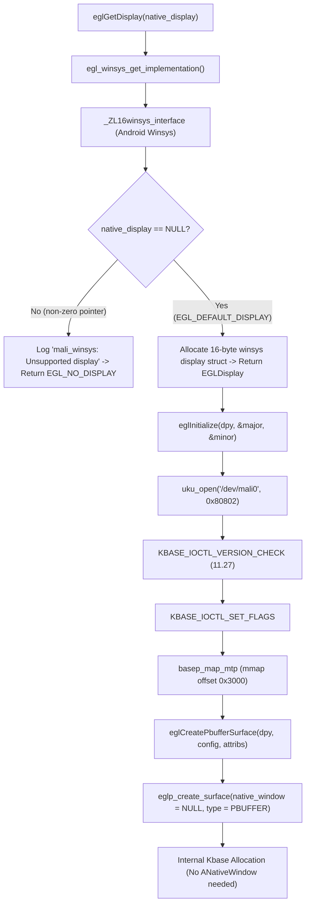

# ELF Dependency & ABI Analysis: libGLES_mali-64.so (Milestone 3A)

- **Target File**: `/vendor/lib64/egl/libGLES_mali.so` (`libGLES_mali-64.so`)
- **SHA-256**: `70b4fd349187346c82648337d2138da3a0b4c36afe14c079e7cfce98f1be9613`
- **File Size**: 53,887,608 bytes (51.4 MB)
- **Architecture**: AArch64 (ARM64 ELF 64-bit LSB shared object)
- **Toolchain / Build String**: `v1.r26p0-01eac0` (built from `vendor/arm/MaliG71_r26p0_LS_R/`)
- **Symbol Integrity**: Unstripped (`.symtab` intact with 191,392 symbols, DWARF debug information present)

---

## 1. Dynamic Linking Requirements (`DT_NEEDED`)

Inspection of ELF program headers and dynamic tags via `readelf -d` reveals exactly 8 shared library dependencies:

| DT_NEEDED Entry | Purpose / Subsystem | Direct Import Count | Essential for Headless / Pbuffer? |
| :--- | :--- | :--- | :--- |
| `libc.so` | Android Bionic C runtime | 215 symbols | **Yes** (core OS primitives, memory, syscalls) |
| `libm.so` | Android Math library | 34 symbols | **Yes** (GLES shader/matrix calculations) |
| `libdl.so` | Dynamic linking interface | 5 symbols | **Yes** (`dlopen`, `dlsym` for extension loading) |
| `libc++.so` | LLVM C++ Standard Library & ABI | 148 symbols | **Yes** (C++ exceptions, RTTI, STL containers) |
| `liblog.so` | Android logging (`logcat`) | 2 symbols | **Yes** (error logging in `winsys`) |
| `libz.so` | DEFLATE compression library | 7 symbols | **Optional / Lazy** (shader cache compression) |
| `libnativewindow.so` | Android `ANativeWindow` / AHardwareBuffer | 5 symbols | **No** (only for EGLImage / Window surfaces) |
| `libion_exynos.so` | Samsung Exynos ION memory allocator | 3 symbols | **No** (only for cross-process buffer sharing) |

---

## 2. Dynamic Import Breakdown & Symbol Classification

`libGLES_mali-64.so` contains 621 entries in its dynamic relocation table (`.rela.dyn` / `.rela.plt`), resolving to 391 unique symbol names across several functional categories.

### 2.1 Android Bionic vs Musl / Glibc Incompatibilities

The proprietary driver was compiled specifically against the Android Bionic C library (API level 28/29). Porting or executing this binary directly on an Alpine / postmarketOS userland (which uses `musl` libc) encounters fundamental ABI divergence:

1. **Thread-Local Storage (TLS) & `errno`**:
   - Bionic defines `__errno()` returning `int *` directly from the thread control block.
   - Musl and glibc define `__errno_location()` returning `int *`.
   - In Bionic, `errno` accesses in `libGLES_mali-64.so` resolve to `bl __errno`.

2. **FORTIFY / Buffer Checking Primitives**:
   - `libGLES_mali-64.so` requires 13 Bionic FORTIFY symbols:
     - `__memcpy_chk`, `__memmove_chk`, `__memset_chk`, `__read_chk`, `__write_chk`
     - `__strchr_chk`, `__strcpy_chk`, `__strlen_chk`, `__strncpy_chk`, `__strncpy_chk2`
     - `__vsnprintf_chk`, `__open_2`, `__stack_chk_fail`
   - In Bionic, `__open_2(const char *path, int flags)` is a non-standard entry point that asserts if `O_CREAT` is passed without a mode. Musl libc does not export `__open_2` or any `__*_chk` symbols.

3. **Global Program Identifiers**:
   - `__progname`: Bionic exports `volatile const char *__progname`, whereas musl defines `program_invocation_name` via glibc compatibility headers.

4. **Pthread Internal Layout**:
   - Bionic `pthread_t` is a pointer to `pthread_internal_t` with specific field offsets for thread ID (`tid`), cleanup stacks, and TLS.
   - Pthread primitives called: `pthread_create`, `pthread_join`, `pthread_mutex_*`, `pthread_cond_*`, `pthread_key_*`, `pthread_rwlock_*`. Calling these across musl/Bionic boundaries without an interception wrapper (such as `libhybris`) causes memory corruption.

### 2.2 Samsung Exynos Vendor Library Analysis (`libion_exynos.so`)

`libion_exynos.so` is required in `DT_NEEDED`, but disassembly reveals that `libGLES_mali-64.so` imports only 3 functions:
- `exynos_ion_open()`: Opens `/dev/ion` and initializes the vendor ION client structure.
- `exynos_ion_alloc()`: Allocates contiguous physical memory from Exynos memory heaps (e.g., `EXYNOS_ION_HEAP_SYSTEM_MASK`, `EXYNOS_ION_HEAP_G2D_MASK`).
- `exynos_ion_close()`: Closes the ION client handle.

**Headless Validation Observation**:
For standalone offscreen Pbuffer rendering, `exynos_ion_*` functions are **never invoked**. Pbuffer surfaces allocate backing store directly via `/dev/mali0` ioctls (`KBASE_IOCTL_MEM_ALLOC`), completely bypassing ION.

### 2.3 Android Native Window Analysis (`libnativewindow.so`)

`libnativewindow.so` exports 5 symbols referenced by `libGLES_mali-64.so`:
- `AHardwareBuffer_acquire`
- `AHardwareBuffer_release`
- `AHardwareBuffer_describe`
- `AHardwareBuffer_allocate`
- `AHardwareBuffer_getNativeHandle`

These symbols are linked to the Android Vulkan swapchain (`_ZN6vulkan46get_android_hardware_buffer_properties_android...`) and `EGL_ANDROID_get_native_client_buffer`. For standard headless EGL Pbuffer creation, none of these symbols are reached at runtime.

---

## 3. Reverse Engineering of EGL Initialization Path

Disassembly of `libGLES_mali-64.so` exposes the internal dispatch architecture governing EGL display creation and surface binding:



### 3.1 Display Selection (`eglGetDisplay` vs `eglGetPlatformDisplayEXT`)

- `eglGetPlatformDisplayEXT(EGL_PLATFORM_SURFACELESS_MESA, ...)`:
  - Token `0x31DC` is explicitly rejected with `EGL_BAD_PARAMETER` (`0x300C`).
  - Reason: The proprietary DDK contains no compile-time Mesa platform adapter.
- `eglGetPlatformDisplayEXT(EGL_PLATFORM_ANDROID_KHR, ...)`:
  - Token `0x3141` is accepted, resolving to the internal Android winsys implementation.
- `eglGetDisplay(EGL_DEFAULT_DISPLAY)` (display_id = `0`):
  - Resolves directly to `_ZL11new_displayPvS_PKi` (`0x774ca0`).
  - Machine code inspection:
    ```asm
    0000000000774ca0 <_ZL11new_displayPvS_PKi>:
      774ca0: a9bf4ffe     stp  x30, x19, [sp, #-0x10]!
      774ca4: b4000140     cbz  x0, 0x774ccc  ; If native_display == 0, branch to success
      774ca8: ...          ; Error path: calls __android_log_print
      774cc0: aa1f03e0     mov  x0, xzr       ; Return NULL (EGL_NO_DISPLAY)
      774cc4: d65f03c0     ret
      774ccc: 52800200     mov  w0, #0x10     ; malloc(16)
      774cd4: bl   malloc
      774cdc: a9004c1f     stp  xzr, x19, [x0]
      774ce4: ret
    ```
  - **Conclusion**: When `native_display == 0`, no window system connection (Wayland, X11, or SurfaceFlinger) is queried or required.

### 3.2 Pbuffer Surface Creation (`eglCreatePbufferSurface`)

Disassembly of `eglCreatePbufferSurface` at `0x78021c`:
```asm
000000000078021c <eglCreatePbufferSurface>:
  78021c: aa0203e3     mov  x3, x2
  780220: 52800024     mov  w4, #0x1                ; Surface type = EGL_PBUFFER_BIT (1)
  780224: aa1f03e2     mov  x2, xzr                 ; native_window = NULL
  780228: 14000585     b    0x78183c <eglp_create_surface>
```
Because `native_window` is passed as `NULL` (`xzr`), `eglp_create_surface` skips all Android `ANativeWindow` buffer queue setup and directly creates an unshared offscreen surface backed by `mali_kbase` GPU allocations.

---

## 4. Execution Feasibility in postmarketOS (Musl vs Bionic)

### 4.1 Running inside Android / Recovery / Halium Userspace
- The proprietary driver executes cleanly when provided with Android Bionic libraries (`libc.so`, `libm.so`, `libdl.so`, `libc++.so`, `liblog.so`).
- Standalone binaries linked against Bionic run without any active Android framework, display server, or `surfaceflinger` daemon.

### 4.2 Running directly on Alpine / postmarketOS (Musl libc)
- **Direct execution**: Impossible without emulation or translation, due to ELF dynamic loader incompatibilities (`ld-musl-aarch64.so` vs `/system/bin/linker64`), incompatible `struct stat`, differing `pthread` struct offsets, and absence of `__errno` / `__*_chk` symbols.
- **Libhybris path**:
  - `libhybris` provides an ELF linker that loads Bionic shared objects into a glibc/musl process, bridging calls between the host and Bionic libraries.
  - However, standard `libhybris` requires a working Android `gralloc` and `sync` driver to support window surfaces. For headless/Pbuffer rendering, a minimal libhybris or lightweight Bionic loader wrapper is sufficient.
- **Standalone Bionic Subsystem / Micro-Container**:
  - A tiny chroot or namespace container housing Bionic `/system/lib64` with a proxy service (or Wayland bridge) can run the Mali driver without polluting postmarketOS's native musl environment.

---

## 5. Summary & Checklist for Display Integration

| Component | Headless / Pbuffer (Milestone 3A) | Onscreen / Display (Milestone 3B / Phase 5) |
| :--- | :--- | :--- |
| **EGL Display** | `eglGetDisplay(EGL_DEFAULT_DISPLAY)` | Requires `ANativeWindow` or `gbm` wrapper |
| **Surface** | `eglCreatePbufferSurface` (No display server) | Requires Framebuffer / HWC / Wayland bridge |
| **Memory Allocation** | Direct `mali_kbase` ioctls | Requires Gralloc / ION / DMA-BUF export |
| **Android Dependencies** | Bionic libc, libm, libdl, libc++, liblog | Bionic + Gralloc HAL + Exynos ION + HWC HAL |
| **Kernel Interface** | `/dev/mali0` (UK ABI 11.27) | `/dev/mali0` + `/dev/fb0` (or Exynos DRM) |
