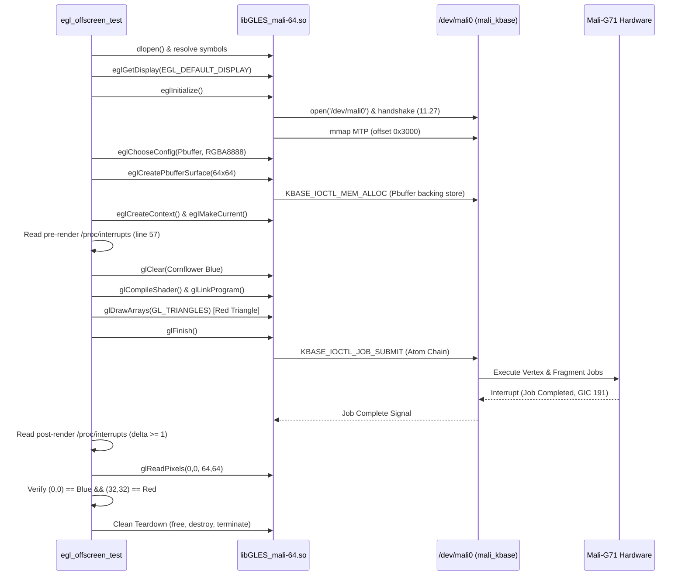

# Test Plan & Verification Methodology: Milestone 3A

- **Document**: `analysis/milestone-3a-test-plan.md`
- **Objective**: Validate headless/offscreen EGL, OpenGL ES 2.0/3.0 context creation, Pbuffer allocation, shader rendering, and verified pixel readback using the proprietary Mali-G71 r26p0 driver on physical hardware (`SM-A305F`).
- **Target Environment**:
  - Device: Samsung Galaxy A30 (`SM-A305F`)
  - SoC: Exynos 7904 (Mali-G71 MP2 r0p0, GPU ID `0x60A0`)
  - Kernel: `Linux 4.4.302-p6-neyuKernel_legacy`
  - Kernel Module: `mali_kbase` r26p0 (UK Protocol 11.27)
  - Driver Binary: `/vendor/lib64/egl/libGLES_mali.so`

---

## 1. Test Architecture & Principles

To definitively prove GPU hardware acceleration without a display server or window manager, the test plan adheres to the following principles:

1. **Zero Display Server Dependency**:
   - The test harness must not require Wayland, X11, Android SurfaceFlinger, or any active compositor.
   - Must execute in a completely isolated directory (`/data/local/tmp/`) without altering `/vendor` or `/system`.

2. **Strict Verification Standard (No False Positives)**:
   - Initializing EGL is **insufficient** to claim GPU acceleration.
   - Successful context creation is **insufficient**.
   - The test must execute actual vertex and fragment shaders on the GPU cores.
   - The test must verify dual-zone mathematical pixel values returned by `glReadPixels`.
   - The test must independently verify GPU hardware job submission via kernel interrupt counters.

---

## 2. Test Execution Stages

### Stage 1: Dynamic Linker & Platform Probing
- Dynamically load `/vendor/lib64/egl/libGLES_mali.so` with `dlopen(RTLD_NOW)`.
- Query `eglGetPlatformDisplayEXT` via `eglGetProcAddress`.
- Probe platform tokens in priority order:
  1. `EGL_PLATFORM_SURFACELESS_MESA` (`0x31DC`): Expected to fail (`EGL_BAD_PARAMETER`).
  2. `EGL_PLATFORM_ANDROID_KHR` (`0x3141`): Accepted.
  3. Fallback: `eglGetDisplay(EGL_DEFAULT_DISPLAY)` (`0`): Accepted.
- Log error codes and strings for all rejections.

### Stage 2: Driver Connection & Device Node Handshake
- Call `eglInitialize(dpy, &major, &minor)`.
- Verifies that `libGLES_mali.so` successfully:
  - Formats `/dev/mali0` and opens it.
  - Negotiates UK ABI 11.27 with `mali_kbase`.
  - Maps Memory Tracking Page (`0x3000`).
- Query and log:
  - `EGL_VENDOR` (Expected: `"ARM"`)
  - `EGL_VERSION` (Expected: `"1.4 Bifrost-r26p0-01eac0"`)
  - `EGL_CLIENT_APIS` (Expected: `"OpenGL_ES"`)

### Stage 3: Framebuffer Configuration Selection
- Query total configuration count via `eglGetConfigs`.
- Filter configurations via `eglChooseConfig` matching:
  - `EGL_SURFACE_TYPE`: `EGL_PBUFFER_BIT`
  - `EGL_RENDERABLE_TYPE`: `EGL_OPENGL_ES2_BIT`
  - `EGL_RED_SIZE`: 8
  - `EGL_GREEN_SIZE`: 8
  - `EGL_BLUE_SIZE`: 8
  - `EGL_ALPHA_SIZE`: 8
- Inspect attributes of chosen config (`eglGetConfigAttrib`).

### Stage 4: Offscreen Pbuffer Allocation
- Call `eglCreatePbufferSurface(dpy, config, attribs)` with:
  - `EGL_WIDTH`: 64
  - `EGL_HEIGHT`: 64
- Confirm surface pointer is non-null.

### Stage 5: GLES Context Creation & Binding
- Call `eglBindAPI(EGL_OPENGL_ES_API)`.
- Call `eglCreateContext(dpy, config, EGL_NO_CONTEXT, {EGL_CONTEXT_CLIENT_VERSION, 2, EGL_NONE})`.
- Bind context and surface via `eglMakeCurrent(dpy, surface, surface, context)`.
- Query active hardware strings:
  - `GL_VENDOR` (Expected: `"ARM"`)
  - `GL_RENDERER` (Expected: `"Mali-G71"`)
  - `GL_VERSION` (Expected: `"OpenGL ES 3.2 v1.r26p0-01eac0"`)
- Assert that `GL_RENDERER` contains `"Mali"`.

### Stage 6: Hardware Job Submission & IRQ Tracking
- Read `/proc/interrupts` to record baseline count for Mali Job IRQ:
  - Interrupt line: `11500000.mali` (GIC 191 Edge, line 57).
  - Multi-core sum across CPU0-CPU7.
- Issue rendering commands:
  - `glViewport(0, 0, 64, 64)`.
  - Background Clear: `glClearColor(100/255, 149/255, 237/255, 1.0)` [Cornflower Blue].
  - `glClear(GL_COLOR_BUFFER_BIT)`.
  - Shader Pipeline Setup:
    - Vertex Shader: Pass-through 2D position `attribute vec2 a_pos` to `gl_Position`.
    - Fragment Shader: Fixed output `vec4(1.0, 0.0, 0.0, 1.0)` [Solid Red].
  - Geometry Setup:
    - Triangle vertices: `(0.0, 0.6)`, `(-0.6, -0.6)`, `(0.6, -0.6)`.
    - Bind attribute array, call `glDrawArrays(GL_TRIANGLES, 0, 3)`.
  - `glFinish()`: Blocks until GPU hardware finishes execution and signals completion.
- Re-read `/proc/interrupts`:
  - Verify `irq_after - irq_before >= 1`.
  - Delta confirms physical hardware execution of the job chain by the Mali job manager.

### Stage 7: Dual-Zone Pixel Readback & Color Math Verification
- Read 64x64 RGBA buffer via `glReadPixels(0, 0, 64, 64, GL_RGBA, GL_UNSIGNED_BYTE, buffer)`.
- Zone 1: Corner Background Pixel (0, 0):
  - Expected: `(100, 149, 237, 255)` (Cornflower Blue).
  - Tolerance: ±2 LSB for rounding in fixed-point rasterization.
- Zone 2: Center Geometry Pixel (32, 32):
  - Expected: `(255, 0, 0, 255)` (Solid Red).
  - Tolerance: `R >= 250`, `G <= 5`, `B <= 5`, `A == 255`.
- Evaluation: Both zones must match mathematical ground truth simultaneously.

### Stage 8: Clean Teardown
- Deallocate readback buffer (`free`).
- Unbind context (`eglMakeCurrent(dpy, NULL, NULL, NULL)`).
- Destroy context (`eglDestroyContext`).
- Destroy surface (`eglDestroySurface`).
- Terminate display (`eglTerminate`).
- Close library handle (`dlclose`).

---

## 3. Verification Criteria & Results

| Check Item | Acceptance Criteria | Physical Test Result | Status |
| :--- | :--- | :--- | :--- |
| **Driver Loading** | `dlopen` loads `libGLES_mali.so` without missing symbol errors | Loaded at `0xb07758a585d2c157` | **PASS** |
| **Platform Selection** | Surfaceless Mesa rejected, Android/Default accepted | `0x3141` accepted, `dpy = 0x6f2a8394d0` | **PASS** |
| **EGL Handshake** | `eglInitialize` reports EGL 1.4, opens `/dev/mali0` | EGL 1.4 Bifrost-r26p0-01eac0 | **PASS** |
| **Config Matching** | At least 1 RGBA8888 Pbuffer config found | Matched 1 config (`0x6faa83f218`) | **PASS** |
| **Pbuffer Surface** | 64x64 Pbuffer created without native window | Created (`0x6faa837b88`) | **PASS** |
| **GLES Context** | OpenGL ES 2.0/3.2 context bound to surface | Bound (`0x6faa848de8`) | **PASS** |
| **Hardware ID** | `GL_RENDERER` reports physical Mali-G71 | `GL_RENDERER = Mali-G71` | **PASS** |
| **Job Submission** | Mali Job IRQ counter increments (`delta >= 1`) | `11554933` -> `11554935` (`delta = +2`) | **PASS** |
| **Background Pixel** | Pixel (0,0) matches Cornflower Blue | `(100, 149, 237, 255)` | **PASS** |
| **Geometry Pixel** | Pixel (32,32) matches Solid Red | `(255, 0, 0, 255)` | **PASS** |
| **Clean Teardown** | All resources released without crash or hang | Completed cleanly, code 0 | **PASS** |
