# postmarketOS Compatibility Boundary: Proprietary Mali Stack (Milestone 3B)

- **Target Device**: Samsung Galaxy A30 (`SM-A305F`)
- **Host / Target OS**: postmarketOS (Alpine Linux / `musl` libc / OpenRC)
- **Active Downstream Kernel**: Linux 4.4.302-p6 (`neyuKernel_legacy` with `mali_kbase r26p0`)
- **Proprietary Userspace Blob**: `libGLES_mali-64.so` (DDK `v1.r26p0-01eac0`)

---

## 1. Android Proof of Concept vs postmarketOS Implementation

It is essential to distinguish between the validated Android-side test harness and a functioning postmarketOS userspace environment:

| Attribute | Validated Proof of Concept (Milestones 3A & 3B) | Production postmarketOS Environment |
| :--- | :--- | :--- |
| **C Runtime** | Android Bionic `libc.so` | Alpine Linux `musl` libc (`ld-musl-aarch64.so.1`) |
| **Dynamic Linker** | `/system/bin/linker64` | `ld-musl-aarch64.so.1` (or `libhybris` linker) |
| **Execution Context** | `/data/local/tmp/` on Android 11 userspace | Native Alpine rootfs (`/usr/lib/`, `/etc/`) |
| **Display Server** | Headless EGL Pbuffer / Offline simulation | Wayland Compositor (`phoc`, `sway`, `tinydm`) |
| **Display Protocol** | Direct DDK calls | Wayland EGL / GBM (`libEGL_mali.so` or `libhybris`) |
| **Device Nodes** | `/dev/mali0`, `/dev/graphics/fb0`, `/dev/ion` | `/dev/mali0`, `/dev/fb0`, `/dev/ion` (or DRM KMS) |

---

## 2. The Libc / Bionic Compatibility Boundary

The proprietary driver was compiled specifically against the Android Bionic C library. Executing `libGLES_mali-64.so` directly under `musl` libc fails immediately at the ELF loader stage due to incompatible dynamic symbols and ABI divergence:

### 2.1 ABI Conflict Breakdown
1. **Thread-Local Storage (TLS) & `errno`**:
   - `libGLES_mali-64.so` expects `__errno()` returning `int *` from the Bionic thread control block.
   - `musl` defines `__errno_location()` returning `int *`.
2. **FORTIFY / Security Checking Entry Points**:
   - `libGLES_mali-64.so` links against 13 Bionic FORTIFY checking symbols:
     - `__memcpy_chk`, `__memmove_chk`, `__memset_chk`, `__read_chk`, `__write_chk`
     - `__strchr_chk`, `__strcpy_chk`, `__strlen_chk`, `__strncpy_chk`, `__strncpy_chk2`
     - `__vsnprintf_chk`, `__open_2`, `__stack_chk_fail`
   - `musl` does not provide any `__*_chk` functions in its shared library exports.
3. **Pthread Struct Layout**:
   - Bionic `pthread_t` points to `struct pthread_internal_t` with distinct field offsets for thread ID, cleanup buffers, and signal masks.
   - Pthread calls across `musl` and `bionic` without ABI translation corrupt stack frames and heap metadata.

### 2.2 Viable Implementation Pathways for postmarketOS

```mermaid
flowchart TD
    subgraph Path A: libhybris
        A1["postmarketOS Wayland Client (musl)"] --> A2["libhybris (libEGL / libGLESv2)"]
        A2 -->|Hybris Linker Bridge| A3["Bionic libGLES_mali-64.so"]
        A3 --> A4["mali_kbase (/dev/mali0)"]
    end

    subgraph Path B: Bionic Micro-Container
        B1["postmarketOS Rootfs (musl)"] -->|Wayland IPC Socket| B2["Isolated Bionic Container / Chroot"]
        B2 --> B3["Android Linker + Bionic Libraries"]
        B3 --> B4["libGLES_mali-64.so"]
        B4 --> B5["mali_kbase (/dev/mali0)"]
    end

    subgraph Path C: Clean-Room Mesa Panfrost
        C1["Native postmarketOS (musl)"] --> C2["Mesa Panfrost (libgallium)"]
        C2 --> C3["Mainline Linux DRM Panfrost (/dev/dri/card0)"]
        C3 --> C4["Mali-G71 Hardware"]
    end
```

- **Path A (`libhybris`)**: The standard approach used by postmarketOS (Halium branch) and Sailfish OS. `libhybris` compiles on musl/glibc and loads Bionic shared libraries into an isolated address range, wrapping function entry points and translating `errno`/pthread primitives.
- **Path B (Bionic Micro-Container)**: An isolated container running Bionic userspace with a proxy compositor (e.g., Wayland bridge or Sommelier) that renders frames in Bionic and shares them with the host compositor.
- **Path C (Upstream Mesa Panfrost)**: Complete upstream solution eliminating Bionic entirely, but requiring long-term gap closure for Mali-G71 (Bifrost v6) in Mesa and DRM.

---

## 3. Kernel & Device Node Prerequisites

To support the proprietary driver stack on postmarketOS, the kernel and udev configuration must provide the following:

### 3.1 Kernel ABI Compatibility
- **`mali_kbase` Kernel Module**: Must be built-in or loaded as an in-tree module matching User-Kernel (UK) protocol **Major 11, Minor 27** (`0x001b000b`).
- **Memory Tracking Page (MTP)**: The kernel must support `mmap` at offset `0x3000` (`PROT_NONE`, `MAP_SHARED`).
- **Device Node**:
  - Node path: `/dev/mali0` (Major 10, Minor 112).
  - Permissions: `0666` or `0660 root:video`.

### 3.2 Memory Allocation & Buffer Sharing (`/dev/ion`)
- **Exynos ION Module**: `CONFIG_ION=y`, `CONFIG_ION_EXYNOS=y`.
- **Device Node**: `/dev/ion` (Major 10, Minor 127).
- **Permissions**: `0666` or `0660 root:video`.
- **DMA-BUF Export**: Required for buffer sharing between GPU and display scanout.

---

## 4. Display Presentation Integration Boundary

The most critical hurdle for postmarketOS on the downstream kernel is the **absence of DRM/KMS (`/dev/dri/card0`)**:
1. Modern desktop Wayland compositors (`phoc`, `sway`, `cage` via `wlroots`) require DRM/KMS (`drmModeGetResources`, `drmModeSetCrtc`, `drmModePageFlip`).
2. The downstream kernel provides only the legacy DECON FBDev driver (`/dev/graphics/fb0`), which:
   - Does not support standard `mmap()` (fails with `-EINVAL`).
   - Requires proprietary `S3CFB_WIN_CONFIG` (`0x441046d1`) with ION DMA-BUFs.
3. **Integration Strategy**:
   - To run Wayland compositors on postmarketOS with this driver:
     - **Halium HWC Backend**: Use a compositor that supports the Android Hardware Composer backend (e.g., Weston with `hwc2` backend or KWin with `libhybris-hwc`).
     - **TinyDRM / Exynos DRM Backport**: Backport a minimal DRM/KMS driver to Linux 4.4 that binds to `14860000.decon_f` and exposes `/dev/dri/card0`.
