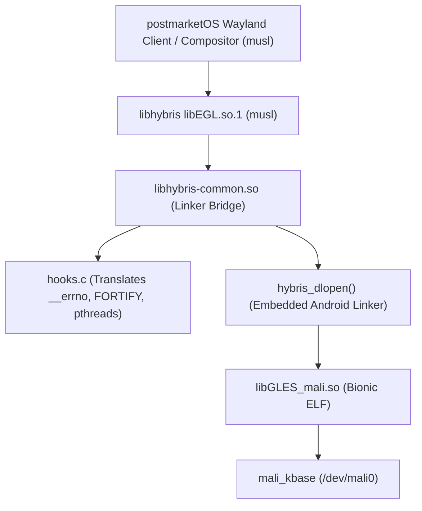

# Milestone 4C: Bionic vs Musl Libc Bridge Architecture

**Target Device**: Samsung Galaxy A30 (`SM-A305F`)  
**Operating System**: postmarketOS (Alpine Linux / musl libc / OpenRC)  
**Kernel**: Linux `4.4.302-p6-neyuKernel_legacy` (Exynos 7904, ARMv8-A AArch64)  
**Proprietary Userspace Blob**: `libGLES_mali-64.so` (Bifrost r26p0, Bionic AArch64)

---

## 1. Executive Summary

Milestone 4C investigates the software architecture required to execute the proprietary Samsung/ARM Mali graphics driver (`libGLES_mali-64.so`) and Exynos display helper libraries inside a standard **postmarketOS** (Alpine Linux) userland.

Because Alpine Linux uses **musl libc** (`ld-musl-aarch64.so.1`) while the vendor Mali driver is compiled strictly against **Android Bionic libc** (`/system/bin/linker64`), native dynamic linking fails at the ELF loading stage. This report catalogs the exact ABI differences, evaluates `libhybris` dynamic linking mechanics, and presents the minimal bridge requirements necessary to expose hardware acceleration to native musl applications.

---

## 2. Comprehensive ABI Divergence Matrix

Analysis of the 621 relocation entries and 391 unique undefined symbols in `libGLES_mali-64.so` categorizes the incompatibilities into four fundamental classes:

| Incompatibility Class | Bionic Implementation | Musl Libc (`ld-musl`) Implementation | Impact on Native Execution |
|---|---|---|---|
| **ELF Dynamic Linker** | `/system/bin/linker64` with custom Android namespace separation | `/lib/ld-musl-aarch64.so.1` standard ELF loader | Dynamic linker rejects Bionic ELF DT_NEEDED resolution |
| **Thread-Local `errno`** | Function call `__errno()` returning `int *` from Bionic TCB | `__errno_location()` returning `int *` | Symbol unresolved at load time |
| **FORTIFY Buffer Checks** | 13 non-standard symbols (`__memcpy_chk`, `__vsnprintf_chk`, `__open_2`, etc.) | Absent from shared library exports | Immediate `undefined symbol` crash |
| **Pthread Control Block** | `pthread_t` is pointer to `pthread_internal_t` | `pthread_t` is pointer to musl `struct pthread` | Fatal memory corruption if pthread objects cross boundary |
| **C++ Standard Library** | LLVM `libc++.so` (Android NDK ABI) | GNU `libstdc++.so` or Alpine `libc++.so` | C++ RTTI and exception frame incompatibilities |

---

## 3. Detailed Symbol Audit

### 3.1 Thread Control & `errno` Bridge
`libGLES_mali-64.so` accesses `errno` via `bl __errno`. In musl libc, `errno` is accessed via `__errno_location()`.
- **Bridge Translation**:
  ```c
  /* In hybris hooks.c */
  extern int *__errno_location(void);
  int *__errno(void) {
      return __errno_location();
  }
  ```

### 3.2 Bionic FORTIFY Symbols
The proprietary driver contains compiled FORTIFY checks across 13 symbols. These symbols must be provided by the compatibility bridge:
1. `__memcpy_chk(dest, src, n, dest_len)` -> checks `n <= dest_len`, calls `memcpy(dest, src, n)`.
2. `__memmove_chk(dest, src, n, dest_len)` -> checks `n <= dest_len`, calls `memmove(dest, src, n)`.
3. `__memset_chk(s, c, n, n_len)` -> checks `n <= n_len`, calls `memset(s, c, n)`.
4. `__read_chk(fd, buf, count, buf_size)` -> checks `count <= buf_size`, calls `read(fd, buf, count)`.
5. `__write_chk(fd, buf, count, buf_size)` -> calls `write(fd, buf, count)`.
6. `__strchr_chk`, `__strcpy_chk`, `__strlen_chk`, `__strncpy_chk`, `__strncpy_chk2` -> standard string bounds checking.
7. `__vsnprintf_chk(s, maxlen, flag, slen, format, va_list)` -> calls `vsnprintf(s, maxlen, format, va_list)`.
8. `__open_2(pathname, flags)` -> validates flags, calls `open(pathname, flags)`.
9. `__stack_chk_fail()` -> calls `abort()`.

### 3.3 Program Names & Logging
- Bionic `__progname`: Mapped to `program_invocation_name` (or static string `"pmos-mali"`).
- `__android_log_print` and `__android_log_write`: Redirected to standard Linux `syslog` or `stderr`.

---

## 4. `libhybris` Dynamic Linking Mechanics

`libhybris` (`scratch/libhybris/hybris/common/q/`) embeds a fork of Android Q/R's `linker64` compiled as a standard Linux library (`libhybris-common.so`).

### Loading Pipeline:


1. **Host Isolation**: The native host process (musl) uses `dlopen()` to load `libEGL.so.1` (compiled against musl).
2. **Hybris Loader**: `libEGL.so.1` initializes the hybris linker bridge (`hybris_dlopen`).
3. **Symbol Redirection**: When `libGLES_mali.so` is loaded, all its `libc.so` imports are resolved to `hooks.c` within `libhybris-common.so`, ensuring Bionic calls map safely to host kernel syscalls or translated musl functions.
4. **Hardware Access**: The loaded driver calls `/dev/mali0` directly via standard Linux ioctls.

---

## 5. Architectural Recommendations for postmarketOS

1. **For Musl Libc (Default postmarketOS)**:
   `libhybris` remains the most mature solution for running Bionic shared objects inside a musl host. Alpine Linux packages `libhybris` for Halium devices, providing a tested pathway for `libEGL` and `libGLESv2` translation.
2. **Alternative: Bionic Display Server Micro-Container**:
   Compile the display server/compositor (e.g. TinyWL or a custom DECON Wayland server) directly against Bionic (using target sysroot), run it as a standalone Linux process on the host, and expose standard Wayland sockets (`/tmp/wayland-0`) to native musl applications. Native musl applications interact exclusively via Wayland IPC protocols, completely avoiding libc cross-linking in client processes.
